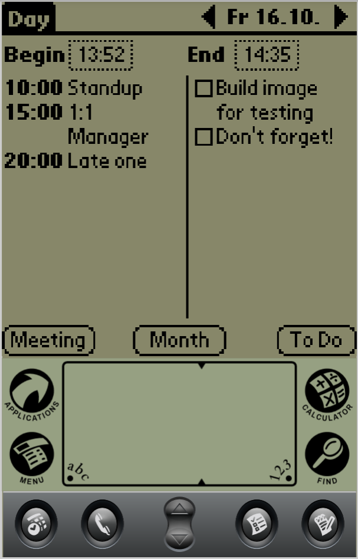
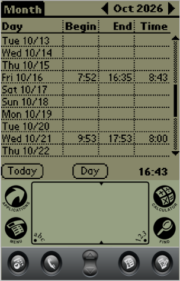
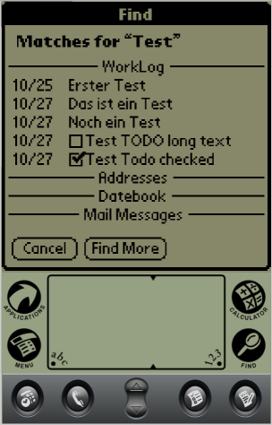

# WorkLog - Palm OS work journal

- **Day view**: begin/end of work, meetings on the left, to-dos on the right.
  - Tap *Begin*/*End* to pick a time (menu: *Begin Now* `/B`, *End Now* `/E`).
  - Tap a meeting or to-do to edit it; tap empty space in a column to add one.
  - Tap a to-do's checkbox to toggle it.
  - Arrows or hardware up/down change the day
  - Events from the built-in Date Book are listed among the meetings,
    marked with a gray bar. They are read-only; private events are hidden.
- **Month view**: begin, end and duration per day, with a monthly total.
  Tap a row to open that day.
- **Support for system-wide-find**: Find button searches for text in both meetings and todos, allowing to jump to the day of the meeting/todo.

## LLM Disclaimer

The initial version has been generated using Claude and Opus 5.5 according to a mockup of me. Subsequent tweaks have been done by hand as well as future development will be as I'm learning Palm OS programming.

## Build

Toolchain setup (once):
- [savaughn/prc-tools-remix](https://github.com/savaughn/prc-tools-remix),
- [jichu4n/pilrc](https://github.com/jichu4n/pilrc)
- [palm-os-sdk](https://github.com/jichu4n/palm-os-sdk)

Native `make `

Or in Docker: `./build.sh`.

## Run

Drag `WorkLog.prc` onto [CloudpilotEmu](https://cloudpilot-emu.github.io)
running a Palm OS ROM (m515 or m500), or HotSync it to a device.

## Data

Database `WorkLogDB-WkJn` (creator `WkJn`, type `DATA`) has the backup bit set,
so HotSync copies it to the desktop. Each record is:

    UInt16 date   days since 1904-01-01
    UInt8  kind   0 = day (begin/end), 1 = meeting, 2 = to-do
    UInt8  flags  bit 0 = to-do done
    Int16  t1     minutes after midnight: day begin / meeting start
    Int16  t2     day end
    char   text[] NUL-terminated

Records are sorted by (date, kind, t1). All values are big-endian.

## Export to PDF

`tools/export_pdf.py` turns the HotSynced database into a PDF with a year
summary, one page per month and one page per week:

    pip install -r tools/requirements.txt
    tools/export_pdf.py WorkLogDB-WkJn.pdb --year 2026 -o worklog-2026.pdf

Options: `--first-day monday|sunday` (default monday), `--page-size a4|letter`
(default a4), `--date-format` (strftime, default `%a %d.%m.`).
